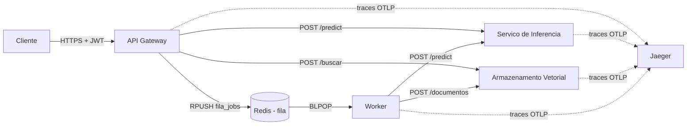

# Plataforma de IA como Serviço (C3.A2)

Projeto integrador cloud-native da disciplina de Sistemas Distribuídos e Computação em Nuvem (FAESA, ADS, 2026/2).
Autor: Caio Borba da Silva Souza (trabalho individual).

A plataforma recebe textos, classifica o sentimento (positivo/negativo) e permite buscar textos parecidos.
O foco do trabalho é a **arquitetura distribuída**, não a sofisticação do modelo: microsserviços, fila, resiliência, observabilidade, segurança e deploy.

**URL pública (Render, plano gratuito):** https://caio-c3-gateway.onrender.com

> No plano gratuito do Render os serviços "dormem" após 15 minutos sem uso. A primeira chamada pode levar cerca de 1 minuto.

## Arquitetura



| Serviço | Papel | Porta | Tecnologia |
|---|---|---|---|
| `gateway` | Ponto de entrada: autentica (JWT), limita requisições, chama os serviços e enfileira jobs | 8000 | FastAPI |
| `inferencia` | Classifica o sentimento do texto | 8001 | FastAPI + scikit-learn (TF-IDF + regressão logística, treinado no build da imagem) |
| `vetorial` | Guarda textos como vetores e busca os mais parecidos (similaridade do cosseno) | 8002 | FastAPI + numpy, persistência em arquivo JSON |
| `worker` | Consome a fila, chama a inferência, guarda o texto no vetorial e grava o resultado | 8003 | FastAPI (laço da fila em uma thread) |
| `redis` | Fila de jobs e resultados temporários (com TTL) | 6379 | Redis 7 |
| `jaeger` | Painel de rastreamento distribuído | 16686 | Jaeger all-in-one |

Fluxos principais:

- **Síncrono:** `POST /predict` → gateway → inferência → resposta imediata.
- **Assíncrono:** `POST /jobs` → gateway grava o job no Redis e responde `202` com o id → o worker processa em segundo plano → o cliente consulta `GET /jobs/{id}`.
- **Busca:** `POST /similares` → gateway → vetorial.

Cada serviço tem seu próprio `Dockerfile` (python:3.12-slim, usuário sem privilégios). A configuração vem sempre de variáveis de ambiente.

## Como rodar do zero (um comando)

Requisitos: Git, Docker com Compose e Python 3 (só para o teste).

```bash
git clone https://github.com/cborba733/sd-2026-2-kit-c3a2.git
cd sd-2026-2-kit-c3a2
docker compose up -d --build
```

Opcional: para trocar senhas e segredos, copie `.env.example` para `.env` e edite antes de subir (o `.env` não vai para o Git).

Aguarde cerca de 30 segundos e confira:

```bash
docker compose ps
python3 scripts/smoke_test.py
```

O teste ponta a ponta deve terminar com `RESULTADO: tudo certo`. Para parar tudo: `docker compose down` (use `-v` para apagar também o volume do armazenamento vetorial).

Credenciais padrão para teste local: usuário `admin`, senha `troque-esta-senha` (**troque em qualquer ambiente real**).

Exemplo de uso manual:

```bash
TOKEN=$(curl -s -X POST localhost:8000/login -H 'content-type: application/json' \
  -d '{"usuario":"admin","senha":"troque-esta-senha"}' | python3 -c 'import sys,json;print(json.load(sys.stdin)["access_token"])')
curl -s -X POST localhost:8000/predict -H "authorization: Bearer $TOKEN" \
  -H 'content-type: application/json' -d '{"texto":"o atendimento foi muito bom"}'
```

## Endpoints do gateway

| Método e rota | Autenticação | Descrição |
|---|---|---|
| `GET /saude` | não | Estado do gateway, da fila e dos disjuntores |
| `POST /login` | não | Troca usuário e senha por um token JWT |
| `POST /predict` | JWT | Classificação de sentimento síncrona |
| `POST /jobs` | JWT | Enfileira um texto para processamento assíncrono (`202`) |
| `GET /jobs/{id}` | JWT | Consulta o status e o resultado (somente o dono do job) |
| `DELETE /jobs/{id}` | JWT | Apaga o resultado e o texto guardado (direito de eliminação, LGPD) |
| `POST /similares` | JWT | Busca os textos mais parecidos no armazenamento vetorial |

Status do job: `na_fila`, `pronto` ou `falhou`.

## Segurança

- **JWT no gateway:** todas as rotas, exceto `/saude` e `/login`, exigem `Authorization: Bearer <token>`. O token é assinado (HS256) e expira (`JWT_EXPIRA_MIN`, padrão 60 minutos). Cada job pertence a quem o criou; outro usuário recebe `404`.
- **Serviços internos protegidos:** inferência e vetorial só aceitam chamadas com o cabeçalho `X-Service-Token` (variável `SERVICE_TOKEN`), comparado em tempo constante. Quem chama direto, sem passar pelo gateway, recebe `401`.
- **Limite de requisições:** `RATE_LIMIT_POR_MIN` por usuário (padrão 30) e limite separado para tentativas de login por IP, devolvendo `429`.
- **HTTPS:** no deploy o Render fornece certificado TLS gerenciado e redireciona HTTP para HTTPS. Localmente o tráfego fica dentro da rede privada do Docker.
- **Segredos fora do código:** `JWT_SEGREDO`, `ADMIN_PASSWORD` e `SERVICE_TOKEN` vêm de variáveis de ambiente (no Render, `generateValue` ou `sync: false`). O `.env` está no `.gitignore`.
- **Contêineres sem root** e entrada validada (tamanho máximo do texto).

## Observabilidade

- **Tracing distribuído (OpenTelemetry + Jaeger):** cada requisição gera um trace que atravessa gateway, fila, worker, inferência e vetorial. A fila não propaga contexto sozinha, então o gateway grava o `traceparent` dentro da mensagem do Redis (span `fila.enfileirar`) e o worker retoma o mesmo trace (span `worker.processar_job`).
- **Como ver:** abra http://localhost:16686, escolha o serviço `gateway`, clique em *Find Traces* e abra um trace de `POST /jobs`. Ele mostra 4 serviços e cerca de 16 spans no mesmo trace.
- **Logs com `trace_id`** em cada linha, para ligar um log ao trace correspondente. Os logs **não** registram o texto enviado pelo usuário.
- **`/saude`** em todos os serviços, usado nos healthchecks do Compose e do Render.

## Resiliência

- **Timeout** em toda chamada entre serviços (`TIMEOUT_SERVICO`, padrão 5 s).
- **Retry com backoff exponencial** (`TENTATIVAS_SERVICO`, padrão 3; `ESPERA_BASE`, padrão 0,5 s): 0,5 s, 1 s, 2 s...
- **Circuit breaker** (fechado, aberto e meio-aberto) por serviço de destino. Com a inferência fora do ar, depois de algumas falhas o gateway deixa de tentar e responde `503` na hora, sem esperar timeout. Depois de um tempo ele testa de novo (meio-aberto). O estado aparece em `/saude`.
- **Fila que absorve falhas:** se o disjuntor da inferência estiver aberto, o worker devolve o job à fila e tenta mais tarde. Se um job falhar 3 vezes, o resultado vira `falhou` e o id vai para a fila de falhas (`fila_jobs_falhas`).
- **Degradação controlada:** se só o armazenamento vetorial falhar, o job termina com o sentimento calculado e `indexado: false`.

Testes feitos: derrubar a inferência (`502` e depois `503` com disjuntor `aberto`), e disparar mais de 30 requisições por minuto (`429`).

## LGPD: dados pessoais, finalidade e retenção

| Item | Descrição |
|---|---|
| **Dados tratados** | Os textos enviados pelo usuário (que podem, por descuido, conter dados pessoais); o nome de usuário (no JWT e como dono do job); o IP do cliente, usado apenas em memória para o limite de login. |
| **Finalidade** | Classificar o sentimento do texto e permitir a busca de textos parecidos. Nenhum outro uso (sem marketing, sem compartilhamento com terceiros, sem treinamento de modelos). |
| **Retenção** | Resultado do job: 1 hora (`RESULT_TTL_SECONDS`). Texto no armazenamento vetorial: 24 horas (`RETENCAO_HORAS`) ou até o `DELETE /jobs/{id}`. Conteúdo de jobs que falharam: 1 hora. Token JWT: 60 minutos. O IP não é gravado. |
| **Minimização** | Os logs não contêm o texto nem dados pessoais, apenas ids de job, tempos e `trace_id`. O armazenamento vetorial guarda só o texto, o sentimento e a confiança. |
| **Direitos do titular** | Eliminação imediata com `DELETE /jobs/{id}`. O acesso a um job é restrito ao seu dono. |
| **Recomendação** | Este é um projeto acadêmico: não envie dados pessoais reais. |

## Relatório de trade-offs

**CAP (consistência, disponibilidade, tolerância a partições).** O sistema prioriza a disponibilidade na escrita e a consistência na leitura. `POST /jobs` continua aceitando trabalho mesmo que o worker ou a inferência estejam fora, porque a fila guarda o job (disponível e eventualmente consistente: o resultado aparece depois). Já `/predict` e `/similares` preferem não responder (`503`) a devolver um resultado errado ou inventado. Há um único Redis e um único arquivo vetorial, sem replicação: em caso de partição ou queda desses componentes, escolhemos perder disponibilidade em vez de dados inconsistentes. Num cenário real, usaríamos Redis replicado e um banco vetorial gerenciado.

**Custo.** Tudo roda no plano gratuito do Render, ao custo de limitações: serviços dormem após 15 minutos (cold start de cerca de 1 minuto), 512 MB e 0,1 CPU por serviço, sistema de arquivos efêmero e o Redis gratuito (Key Value) sem persistência. Por isso o worker roda como *web service* gratuito (workers de fundo não são gratuitos) e é acordado pelo gateway. Em produção, um plano pago com instâncias sempre ligadas e disco persistente resolveria isso por poucos dólares por serviço ao mês.

**Latência.** `/predict` síncrono responde em poucos milissegundos (o modelo é leve e carregado na memória). O caminho assíncrono troca latência por robustez: o cliente recebe o `202` em cerca de 5 ms, mas o resultado só chega depois do worker (dezenas de ms localmente, mais no deploy gratuito por causa do cold start). Retries e backoff aumentam a latência no pior caso, e o circuit breaker a reduz quando o destino já está caído (falha rápida). O tracing acrescenta uma sobrecarga pequena, aceitável pelo ganho de diagnóstico.

**Outras escolhas.** Embeddings por hashing (sem modelo pesado e sem estado) permitem o serviço vetorial ser pequeno e determinístico, ao custo de menor qualidade semântica. A comunicação entre serviços é HTTP síncrono (simples de depurar) e a fila só entra onde o desacoplamento compensa.

## Estrutura do repositório

```text
gateway/      API Gateway (JWT, limite, disjuntor, fila)
inferencia/   serviço de inferência (modelo de sentimento)
vetorial/     armazenamento vetorial (embeddings + busca)
worker/       consumidor da fila
comum/        código compartilhado (logs, JWT/token, tracing, resiliência)
scripts/      smoke_test.py (teste ponta a ponta)
docker-compose.yml   sobe os 6 serviços com um comando
render.yaml          blueprint do deploy no Render
.env.example         variáveis de ambiente de exemplo
```

## Testes

`python3 scripts/smoke_test.py [URL] [--limite]` verifica: `/saude`, recusa sem token (`401`), login certo e errado, `/predict`, fila + worker, armazenamento vetorial, `/similares` e `DELETE`. Com `--limite` testa também o `429`. Funciona contra o Compose local e contra a URL pública.

## Deploy no Render (plano gratuito)

O `render.yaml` cria de uma vez os 4 serviços (web services Docker gratuitos) e o Redis (Key Value). No painel do Render: **New > Blueprint** e escolha este repositório. O Render pede os segredos `SERVICE_TOKEN` (o mesmo valor nos 4 serviços) e `ADMIN_PASSWORD`. Eles ficam só no painel, nunca no repositório.

URL pública do gateway: https://caio-c3-gateway.onrender.com (HTTPS com certificado gerenciado pelo Render).

Teste contra a URL pública:

```bash
ADMIN_PASSWORD='sua-senha' python3 scripts/smoke_test.py https://caio-c3-gateway.onrender.com
```

Observações do plano gratuito: os serviços dormem após 15 minutos sem uso (a primeira chamada demora cerca de 1 minuto); o worker roda como web service gratuito e é acordado pelo gateway; o Redis gratuito não persiste dados; o arquivo do armazenamento vetorial é efêmero; o Jaeger roda só no `docker compose` local.

Tempos de despertar medidos no plano gratuito (serviço dormindo): inferência cerca de 38 s, vetorial 18 s e worker 13 s. Por isso o gateway e o worker usam timeout de 60 s , 4 tentativas e espera inicial de 10 s (10 s, 20 s, 40 s). Se a primeira chamada depois de um tempo parado devolver `502`, aguarde cerca de 1 minuto e repita: os serviços já estarão acordados.

**Importante (cold start no plano gratuito):** no Render gratuito, um serviço dormindo só acorda com chamadas vindas de fora do Render; chamadas entre serviços recebem `502` e não os acordam. Por isso, antes de testar a URL pública, abra https://caio-c3-gateway.onrender.com no navegador e espere a página mostrar todos os serviços como "pronto" (cerca de 1 minuto). O `scripts/smoke_test.py` faz isso sozinho. Em um plano pago, com instâncias sempre ligadas, essa etapa não existe.

### Testando pelo navegador (`/docs`)

1. Abra https://caio-c3-gateway.onrender.com e espere os serviços ficarem "pronto".
2. Abra `/docs`, entre em `POST /login` > **Try it out**, informe `{"usuario": "admin", "senha": "<senha de teste>"}` e clique em **Execute**.
3. Copie o valor de `access_token` (sem as aspas), clique em **Authorize** no topo, cole no campo **Value** e confirme.
4. Use as demais rotas (`/predict`, `/jobs`, `/similares`...) com **Try it out**. O token vale 60 minutos.
